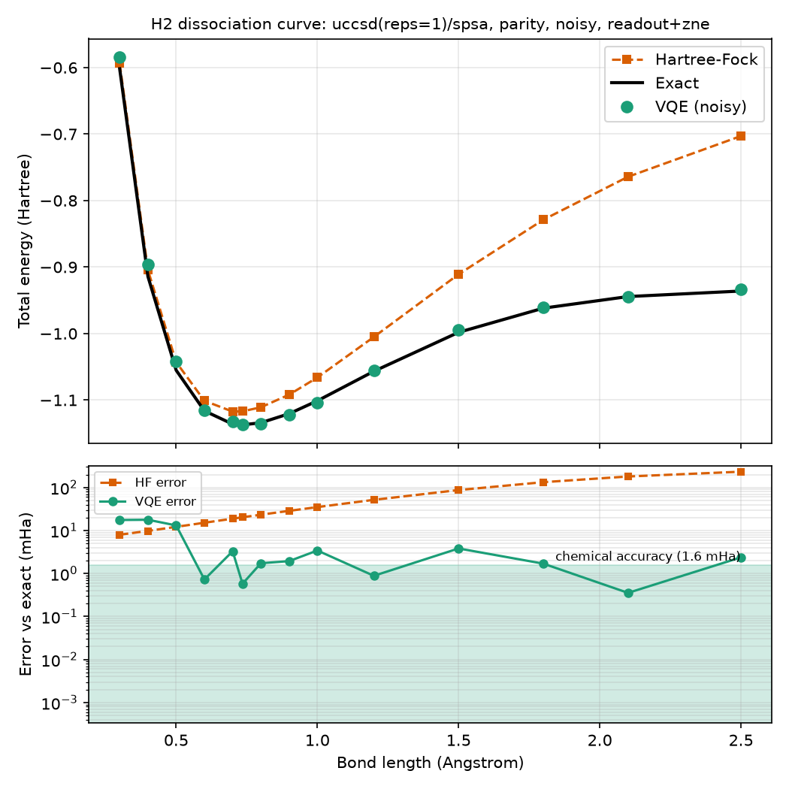
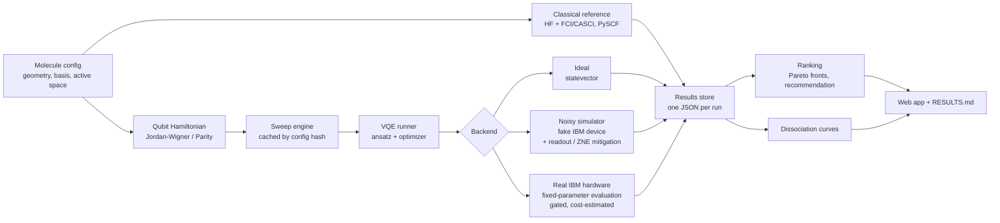
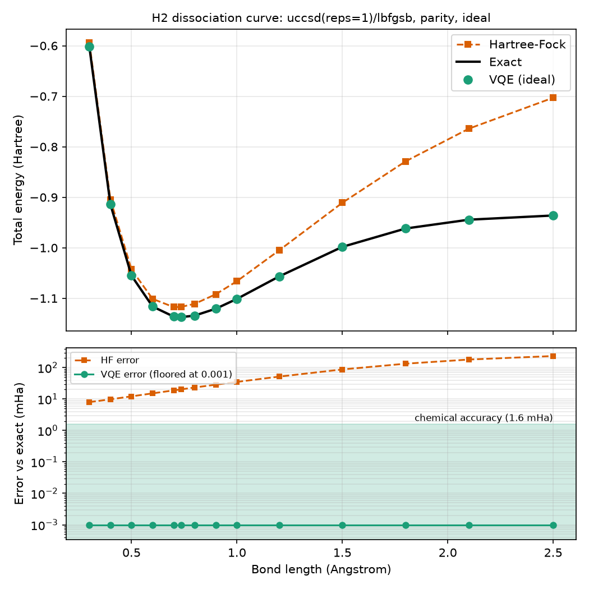

# MiraiChem

**Team Mirai · Q-Hack India 2026 · Track: Quantum Biotech & Chemistry**

[](https://github.com/S-tevens/miraichem/actions/workflows/ci.yml)

MiraiChem is an automated benchmarking and recommendation pipeline that finds the most reliable
VQE configuration (ansatz, optimizer, qubit mapping, error mitigation, shots) for simulating a small
molecule on a noisy IBM quantum backend, and checks the recommendation on real IBM hardware.



*H2 potential-energy curve from the noisy simulator (UCCSD, Parity mapping, readout + ZNE
mitigation). Hartree-Fock fails as the bond stretches; mitigated VQE follows the exact curve.*

## Contents

1. [Problem](#1-problem)
2. [Our solution and what is new](#2-our-solution-and-what-is-new)
3. [Architecture](#3-architecture)
4. [Tech stack](#4-tech-stack)
5. [Setup](#5-setup)
6. [How to run](#6-how-to-run)
7. [Results](#7-results)
8. [Limitations and honest notes](#8-limitations-and-honest-notes)
9. [Roadmap](#9-roadmap)
10. [References](#10-references)
11. [Team](#11-team)

## 1. Problem

The variational quantum eigensolver (VQE) estimates a molecule's ground-state energy by tuning a
parameterised quantum circuit. On today's noisy devices the answer depends heavily on choices that
are usually made by trial and error:

- **ansatz** (the circuit shape: chemistry-inspired UCCSD or shallow hardware-efficient),
- **fermion-to-qubit mapping** (Jordan-Wigner or Parity, which differ in qubit count and depth),
- **classical optimizer** (COBYLA, SPSA, L-BFGS-B),
- **error mitigation** (readout correction, zero-noise extrapolation) and the **shot budget**.

A setup that works on an ideal simulator often fails on real hardware, and scarce hardware time is
wasted finding that out. Our own results show the size of the effect. One H2 configuration (UCCSD,
Parity mapping) has an error of 0.4 mHa on an ideal simulator, 84.5 mHa on a real IBM device without
mitigation, and 3.0 mHa on the same device with readout + zero-noise-extrapolation mitigation
(chemical accuracy is 1.6 mHa).

## 2. Our solution and what is new

MiraiChem takes a molecule and does the following:

1. Computes classical reference energies (Hartree-Fock and exact FCI/CASCI) with PySCF.
2. Builds the qubit Hamiltonian under one or more mappings.
3. **Sweeps** many VQE configurations on an ideal simulator and on a noisy simulator that uses the
   noise model and connectivity of a real IBM device (fake backend).
4. Records metrics for every run: error vs exact, transpiled depth, two-qubit gates, shots, time.
5. **Ranks** the runs, computes Pareto fronts (accuracy vs cost), and **recommends** a configuration
   with a justification built from the real numbers.
6. Scans the recommended configurations over bond lengths (dissociation curves).
7. **Validates on real IBM hardware** by evaluating the best simulator parameters on a device with
   and without mitigation.
8. **Predicts a configuration's error before you run it**, with an interval that has been checked on
   configurations the model never saw.
9. Shows everything in a web app that browses saved results and can launch simulator runs and sweeps.
10. **Gives a trust report** for each recommendation: what was checked and a verdict by fixed, visible rules.

**What is new is the engineering, not the chemistry.** We do not claim a new chemistry method or a
quantum advantage (H2 and LiH are trivial for classical computers). The contribution is a
reproducible, configurable, cost-aware benchmark with these distinguishing features:

- **Whole-curve recommendation.** A configuration that is chemically accurate at equilibrium can
  fail when the bond is stretched. In our data a shallow ansatz was the cheapest accurate choice at
  equilibrium but only 79% accurate over the curve (worst error 44 mHa). The recommender therefore
  judges configurations by worst-case error and coverage across a scan.
- **Mitigation measured per evaluation.** Mitigated and unmitigated energies are stored together,
  so "before vs after" is a plot, on the simulator and on hardware.
- **Hardware-aware simulation.** The noisy backend runs a real shot-based measurement pipeline
  (grouped Pauli measurements, readout errors, gate errors), which is what makes readout
  mitigation and gate-folding ZNE meaningful.
- **Simulator checked against hardware.** The recommended configurations were evaluated on a real
  IBM device, so the simulator's predictions are tested instead of assumed.
- **Trust report.** For each recommendation: how many seeds, how often it reached chemical accuracy,
  whether other devices and the error forecast agree, whether a real device was tried and, for SQD, the
  control experiments below. The verdict (trusted, partly, not yet, not enough evidence) follows rules the
  page prints, and it is often "not yet": most noisy H2 setups do not reach chemical accuracy reliably.
- **Controls that test the quantum step.** For SQD we compare the circuit's subspace with random and
  classical subspaces of the same size and run the loop with the circuit replaced, and report the results
  whichever way they fall.
- **Reproducibility.** Every run has a config hash, a seed, library versions and the git commit,
  and finished runs are cached, so sweeps can be stopped and resumed.

## 3. Architecture



| Module | What it does |
|---|---|
| `config.py` | Pydantic models for molecules, runs and sweeps; stable config hashing; invalid-combination rules |
| `chemistry/` | PySCF molecules, active-space selection, HF and FCI/CASCI reference energies |
| `mapping/` | Fermion-to-qubit mapping (Jordan-Wigner, Parity), qubit Hamiltonian, exact-energy check |
| `ansatz/` | UCCSD and hardware-efficient ansatz, both starting from the Hartree-Fock state |
| `optim/` | COBYLA, SPSA, step-clipped SPSA (`spsa_clip`) and L-BFGS-B behind one interface; budgets counted in evaluations |
| `backends/` | Ideal statevector, noisy Aer simulator with a fake IBM device, gated real-hardware backend |
| `mitigation/` | Readout (measurement) mitigation and gate-folding zero-noise extrapolation |
| `vqe/` | The VQE loop, per-run failure capture and the saved `RunResult` record |
| `benchmark/` | Sweep engine, metrics, ranking, scan ranking, storage, report generation |
| `analysis/` | Dissociation curves (matplotlib and plotly) |
| `predict/` | The error predictor: forecasts a noisy run's error with an interval, checked on unseen configurations and devices |
| `sqd/` | Sample-based quantum diagonalization: the problem and classical references, the sampler (circuit, device noise model, control samplers), the recover-and-solve loop, the controls, and the hardware path |
| `cli.py`, `api/`, `frontend/` | Command-line interface, the web API (`miraichem serve`, including the SQD results and the trust report) and the web app |

The diagram above is the VQE pipeline. The SQD engine, the controls, the trust report and the hardware gates
are drawn in [docs/ARCHITECTURE.md](docs/ARCHITECTURE.md) (section 1.1 is the whole system).

Design decisions and alternatives we rejected are recorded in
[docs/DECISIONS.md](docs/DECISIONS.md). A generated summary of every result is in
[docs/RESULTS.md](docs/RESULTS.md).

## 4. Tech stack

Python 3.11. Versions are pinned in [requirements.txt](requirements.txt).

| Purpose | Package |
|---|---|
| Quantum circuits and primitives | `qiskit` 2.5.2, `qiskit-aer` 0.17.2, `qiskit-ibm-runtime` 0.50.0 |
| Chemistry to qubits | `qiskit-nature` 0.8.0, `qiskit-algorithms` 0.4.0, `pyscf` 2.14.0 |
| Numerics and data | `numpy` 2.2.6, `scipy` 1.17.1, `pandas` 2.3.3, `pyarrow` 25.0.1 |
| Configuration and CLI | `pydantic` 2.13.5, `pyyaml` 6.0.3, `typer` 0.27.2, `rich` 15.0.0, `python-dotenv` 1.2.4 |
| Plots | `matplotlib` 3.11.2, `plotly` 7.1.0 |
| Web app | `fastapi` 0.146.0, `uvicorn` 0.54.0 (API); React, TypeScript and Vite (interface) |
| Development | `pytest` 9.1.1, `ruff` 0.16.10, `mypy` 2.4.0 |

## 5. Setup

**Prerequisites:** Python 3.11, git, and a Linux or macOS shell.

> **Windows:** PySCF does not publish Windows wheels, so use **WSL2** (Ubuntu) and run everything
> below inside it. See [docs/DECISIONS.md](docs/DECISIONS.md).

```bash
# 1. clone
git clone https://github.com/S-tevens/miraichem.git
cd miraichem

# 2. create an environment and install (uv shown; plain pip also works)
curl -LsSf https://astral.sh/uv/install.sh | sh        # skip if uv is installed
uv venv --python 3.11 .venv
source .venv/bin/activate
uv pip install -r requirements.txt
uv pip install -e . --no-deps

# alternative without uv:
#   python3.11 -m venv .venv && source .venv/bin/activate
#   pip install -r requirements.txt && pip install -e . --no-deps
```

**IBM Quantum token (optional, only needed for real hardware).** Everything else works offline.

```bash
cp .env.example .env
# edit .env and fill in IBM_QUANTUM_TOKEN and IBM_QUANTUM_INSTANCE
```

`.env` is gitignored; never commit a token.

**Check the install** (about 3 minutes, no hardware, no network):

```bash
pytest -q
```

To verify the whole README on a brand-new clone (install, tests, quick demo, API), run
`scripts/fresh_clone_check.sh`; it reports what passed and what failed.

## 6. How to run

All commands run from the repository root.

### Quick demo (about 1 minute)

```bash
# 16 H2 runs on ideal and noisy simulators (about 40 s with 4 workers)
miraichem sweep configs/sweeps/quick_h2.yaml --max-workers 4

# leaderboard, Pareto marks and a recommendation built from the real numbers
miraichem rank --molecule h2 --backend noisy
miraichem rank --molecule h2 --backend ideal

# the web app (open http://localhost:8000; see "The web app" below)
miraichem serve
```

Results are saved to `results/<molecule>/<hash>.json`. Re-running a sweep skips finished runs
(`--force` repeats them).

> **The quick demo is a 16-run subset** of our full benchmark, so its recommendations and numbers
> differ from the [Results](#7-results) section below. Our complete runs (267 simulator runs, the
> dissociation curves and the real-hardware jobs) are published in this repository; see the next
> section to explore them without re-running anything.

### Demo notebook (about 2 minutes)

[`notebooks/01_h2_end_to_end_demo.ipynb`](notebooks/01_h2_end_to_end_demo.ipynb) walks through the whole
pipeline on H2: reference energies, the qubit Hamiltonian, an ideal VQE run, a noisy run with and without
mitigation, a sweep with ranking and a recommendation, a dissociation curve, and the hardware cost gate
and our saved hardware results. It only calls the package, uses no hardware time, and is saved with its
outputs, so you can also read it directly on GitHub.

```bash
jupyter lab notebooks/01_h2_end_to_end_demo.ipynb    # then Run > Run All Cells
```

### The web app

[`frontend/`](frontend) is the interface to the whole package (React, TypeScript, Vite), served by a small
API (`miraichem serve`, FastAPI). It has a sidebar with a switch between the published results and your own
runs, and these pages:

- **Overview, Leaderboard, Seed reliability, Devices, Dissociation curves, Real hardware:** browse and rank
  saved results. The leaderboard has live scoring weights and a Pareto chart; Seed reliability shows every
  configuration over its random seeds with an adjustable, statistics-based recommendation. Any run opens in a
  panel with its convergence curve, energies, cost, provenance and the command that reproduces it.
- **New run and Sweeps:** configure a single VQE run, or start one of the prepared sweeps, on the ideal or
  noisy simulator, with live progress. Results are saved like CLI runs. Invalid combinations (for example
  L-BFGS-B on a noisy backend) are explained before you run.
- **Trust report:** the evidence behind each recommendation and a verdict (see above). A link opens it from
  the Overview and the Leaderboard.
- **SQD, larger molecules:** the SQD results, a 3D molecule and orbital viewer, the stretched-bond study, the
  control experiments, the scaling study and a real-device panel. Every chart has an enlarge button.
- **Jobs and How it works.**

VQE runs on real hardware stay in the command line (opt-in flag, cost estimate, confirmation). SQD on real
hardware can be started from the SQD page after a plan and an "are you sure" step; `--no-allow-hardware`
switches it off. The server listens on this computer only unless you pass `--allow-remote`.

```bash
# build the interface once (Node 18 or newer), then start the app and open http://localhost:8000
npm --prefix frontend install
npm --prefix frontend run build
miraichem serve

# development: the API on :8000 plus the interface with hot reload on :5173
miraichem serve
npm --prefix frontend run dev
```

### Offline demo (no Python, no server)

The same interface also builds as a **read-only static demo** of the published results. It is plain files, so
it opens on any machine with a file server, needs no installation, and cannot break because of a missing
dependency or a stopped server. Starting runs, sweeps, training and forecasts are disabled in it, and it says so.

Every push builds it in CI: download the `miraichem-offline-demo` artifact from the latest run of
[CI](https://github.com/S-tevens/miraichem/actions/workflows/ci.yml), unzip it, and serve the folder:

```bash
python3 -m http.server 8080 --directory miraichem-offline-demo      # then open http://localhost:8080
```

Or build it yourself (the export step needs the Python install):

```bash
npm --prefix frontend install
npm --prefix frontend run build:demo      # the interface, into frontend/dist-demo
miraichem export-demo                     # the data, into frontend/dist-demo/demo
python3 -m http.server 8080 --directory frontend/dist-demo
```

### Predict a run's error before running it

The **Error predictor** page and the forecast on the **New run** page estimate how a noisy configuration will
do before you spend any compute: from the transpiled circuit size on the chosen device, the optimizer and
its budget, the mitigation, the shots, the molecule's Hartree-Fock error and a summary of the device's noise.
It is a random forest trained on the saved noisy runs (1,456 runs from 277 configurations), and it is checked
only on configurations it has not seen:

| | Typical error factor | R² |
|---|---|---|
| Predictor | **1.75×** | 0.82 |
| Guessing the molecule's average | 4.23× | 0.02 |
| Guessing the overall average | 4.34× | -0.01 |

- **The uncertainty is calibrated.** The stated 80% interval contained the measured error 79% of the time,
  calibrated on other folds only.
- **It transfers to unseen devices, less precisely:** 1.7× to 2.4× when a whole device (Brisbane, Kyiv,
  Torino, Fez) is left out of training. Holding out Sherbrooke, which supplies 78% of the runs, is not a fair
  test and is labelled as such.
- **It relies mostly on** the number of qubits, whether readout correction is on, the mapping and the
  optimizer.
- **Limits:** it knows H2 on five simulated devices and LiH on one, forecasts the noisy simulator (not ideal
  runs or real hardware), and warns when asked about something outside that. It predicts one run with a
  random seed, so an interval is part of the answer.

```bash
miraichem predictor train      # learn from results/ and print the validation
miraichem predictor show       # print how a saved model validated
```

The trained model is committed under `results/published/models/`, so the app can forecast on a fresh clone;
train your own from the Error predictor page once you have more runs.

### Explore our published results (no computation needed)

The full results are committed under [`results/published/`](results/published). They hold every run
behind the numbers in this README and in [docs/RESULTS.md](docs/RESULTS.md), including the job IDs of
the real-hardware runs.

```bash
# the web app: choose "Published" in the sidebar to browse these results
miraichem serve

# the same leaderboards and recommendations from the command line
miraichem rank --molecule h2 --backend noisy --results-dir results/published
miraichem rank --molecule h2 --backend noisy --results-dir results/published --scan
miraichem rank --molecule h2 --backend noisy --replicated     --runs-csv results/published/summary/replication_runs.csv

# regenerate docs/RESULTS.md from the published data (identical apart from the date)
miraichem report --results-dir results/published --hardware-dir results/published/hardware \
    --export-dir /tmp/miraichem_summary
```

### More commands

```bash
# one run, and classical reference energies
miraichem run --molecule configs/molecules/h2.yaml --ansatz uccsd --optimizer lbfgsb --backend ideal
miraichem reference --molecule configs/molecules/h2.yaml --bond-length 0.735

# full sweeps
miraichem sweep configs/sweeps/full_h2.yaml --max-workers 4            # 114 runs, about 7 min
miraichem sweep configs/sweeps/full_lih.yaml --max-workers 4           # 22 runs, about 6.5 min
miraichem sweep configs/sweeps/lih_noisy_extended.yaml --max-workers 4 # 40 runs, about 21 min

# rank across a bond-length scan (judges configurations by worst case, not one geometry)
miraichem curve --molecule configs/molecules/h2.yaml --backend ideal --max-workers 4
miraichem rank --molecule h2 --backend ideal --scan

# repeat configurations over seeds, then rank by mean error and recommend what you can trust
miraichem sweep configs/sweeps/h2_replication.yaml --max-workers 8     # 10 seeds, about 30 min
miraichem replicate --molecule H2                                       # mean +/- std per configuration
miraichem rank --molecule h2 --backend noisy --replicated

# dissociation curve of a specific saved run, and the written report
miraichem curve --molecule configs/molecules/h2.yaml --config-hash <hash>
miraichem report            # writes docs/RESULTS.md and results/summary/summary.{csv,parquet}
```

### SQD: larger active spaces (simulated sampling, or a real device)

Sample-based quantum diagonalization (SQD) samples bitstrings from a circuit, repairs the ones with
the wrong electron count (configuration recovery), post-selects, and solves the molecule exactly
inside the small subspace they span. Only the sampling step is quantum, so it reaches far more qubits
than VQE. It is in the web app (page "SQD, larger molecules") and on the command line:

```bash
# 20 qubits (N2, STO-3G), simulated sampling, checked against the exact energy
miraichem sqd --molecule configs/sqd/n2.yaml --readout-noise 0.02

# the seed study behind the published SQD results
python scripts/run_sqd_study.py results/published

# the scaling study (20 to 32 qubits); the one-off 32-qubit exact solve takes about 9 minutes
python scripts/run_sqd_scaling.py --molecules n2 n2_631g_24q n2_631g_28q n2_631g

# an open-shell molecule, and a device-calibrated noise model
miraichem sqd --molecule configs/sqd/o2.yaml --readout-noise 0.02 --n-reps 2
miraichem sqd --molecule configs/sqd/n2.yaml --noise-model FakeFez
```

Molecules in `configs/sqd/` (the bond length is set in each file):

| File | Molecule | Qubits | Exact reference |
|---|---|---|---|
| `n2.yaml` | N2, STO-3G | 20 | yes |
| `n2_631g_24q.yaml` | N2, 6-31G, 12 active orbitals | 24 | yes (6 s) |
| `n2_631g_28q.yaml` | N2, 6-31G, 14 active orbitals | 28 | yes (52 s) |
| `n2_631g.yaml` | N2, 6-31G, 16 active orbitals | 32 | yes, one-off 530 s, then saved |
| `n2_ccpvdz.yaml` | N2, cc-pVDZ | 52 | no: real hardware only |
| `o2.yaml` | O2 triplet, STO-3G (open-shell) | 20 | yes |
| `no.yaml` | NO radical, STO-3G (open-shell, doublet) | 20 | yes |

Open-shell molecules use ROHF orbitals, an unrestricted CCSD and a spin-unbalanced circuit; the VQE
pipeline still refuses them. The exact (FCI) energy is only solved automatically when it is cheap
(under 5 million determinants). For bigger spaces ask for it once with `--exact` (or the checkbox in
the app); it is saved in `results/exact/`, so it never runs again. Without it, results are compared
with Hartree-Fock and CCSD. `--noise-model FakeFez` replaces the uniform bit flips with a
device-calibrated model: per-qubit readout errors and the chance a shot survives every gate, taken
from a fake IBM device and the circuit as compiled for it. It is an approximation, not a simulation
of the noisy circuit.

The SQD page also shows each molecule and its orbitals in 3D (drag to rotate, click to enlarge) and
every chart has an enlarge button. The orbital surfaces are real (PySCF, STO-3G) and are generated by
`scripts/make_structures.py` (needs scikit-image; the output is committed). FeS4 and Fe4S4 are shown as
idealised shapes only, labelled as such: no orbitals were computed for them.

#### SQD results so far (simulated sampling)

Same settings at every size: noise 0.02, 3 rounds, 300 samples per batch, 20,000 shots. Mean error
against the exact energy in mHa (chemical accuracy is 1.6):

| Molecule | Qubits | Hartree-Fock | CCSD | SQD, 1 layer | SQD, 2 layers | Seeds |
|---|---|---|---|---|---|---|
| N2 | 20 | 156.9 | 3.9 | 2.45 | 0.72 | 10 |
| N2, 6-31G | 24 | 131.8 | 3.0 | 10.1 | 8.3 | 5 |
| N2, 6-31G | 28 | 172.3 | 7.1 | 14.1 | 11.3 | 5 |
| N2, 6-31G | 32 | 235.2 | 9.4 | 21.3 | 19.0 | 5 |
| O2 triplet | 20 | 112.0 | 2.1 | 7.5 | 5.2 | 10 |
| NO doublet | 20 | 133.3 | 5.0 | 5.6 | 12.9 | 10 |

How to read this honestly:

- Only the 20-qubit N2 reaches chemical accuracy (with 2 layers). At every larger size, and for both
  open-shell molecules, classical CCSD is more accurate than our simulated SQD. We make no claim that
  SQD beats classical methods; the value so far is that the pipeline runs and can be checked against
  an exact answer up to 32 qubits.
- With these fixed settings the error grows with size. Tripling the batch to 1,000 samples changes
  little (24 qubits: 10.1 to 9.9; 28: 14.1 to 14.2; 32: 21.3 to 22.8 with one layer, 19.0 to 15.6 with
  two), so the batch size alone is not the limit.
- More circuit layers helped for N2 and O2 but made NO worse (5.6 to 12.9), which we have not explained.
- The device-calibrated noise model (FakeFez, 3 seeds) gives exactly 0.00 at 20 qubits, because the
  samples are so spread out that the subspace covers all 14,400 determinants and SQD becomes exact
  diagonalisation: that size cannot test noise robustness. At 24, 28 and 32 qubits it gives about 5,
  20 to 24, and 42 to 51 mHa, worse than the uniform bit flips at the larger sizes.
- Everything above is simulated sampling. Five real-hardware SQD runs are published (the SQD page shows each
  next to an ideal simulation of the same circuit):

  | IBM job | Device | Qubits | Error vs exact | Space solved | Ideal circuit (same gates) |
  |---|---|---|---|---|---|
  | `dbibe2o1h92s73834cvg` | `ibm_fez` | 20 | 0.057 mHa | 68% | 45.9 mHa, 15 distinct bitstrings |
  | `dbidbb6ne4hc73bebir0` | `ibm_fez` | 20 | 0.0022 mHa | 77% | 54.1 mHa, 12 distinct bitstrings |
  | `dbide1ene4hc73beboog` | `ibm_kingston` | 20 | 0.0011 mHa | 72% | 54.1 mHa, 12 distinct bitstrings |
  | `dbijilg1h92s7383jvq0` | `ibm_fez` | 20 (bond stretched to 2.0 A) | 0.123 mHa | 59% | 85.7 mHa, 38 distinct bitstrings |
  | `dbiefoo1h92s7383a180` | `ibm_fez` | 52 (N2, cc-pVDZ) | no exact energy | 0.0065% | cannot be simulated |

  Each 20-qubit run used about 5 s of QPU time. The device's noise spread the samples over thousands of
  bitstrings (the ideal circuit gives 12 to 38), so each solve covered most of the 14,400 determinants and
  was close to exact diagonalisation: these runs show the hardware path works end to end, not that SQD
  tolerates noise at scale or beats classical methods. The 52-qubit run (1,948 two-qubit gates) returned
  10,000 distinct bitstrings from 10,000 shots, which is noise; its energy is 169.5 mHa below
  Hartree-Fock and 139.8 mHa above the CCSD energy. It shows a 52-qubit job runs end to end, nothing more.
  The stretched-bond run (N2 at 2.0 A, 258 two-qubit gates, 5.0 s of QPU time) ended 0.123 mHa from exact,
  where CCSD is 101.8 mHa off. It solved 59% of the space, so it is close to exact diagonalisation too; it
  shows the hardware path works at a stretched bond, not that the device's samples are what fixed CCSD's error.

#### Stretched bonds: where coupled cluster breaks down

N2 has a triple bond, the textbook case where CCSD fails as the atoms move apart. The same SQD setting
is run at every distance (noise 0.02, 3 rounds, 300 samples per batch, 5 seeds; the equilibrium row
is the 10-seed study) with `scripts/run_sqd_stretch.py`, and every point is checked against the exact
energy. Mean error in mHa; the last column is the share of the full space the one-layer solve covers.

20 qubits (N2, STO-3G, 14,400 determinants):

| Bond (A) | Hartree-Fock | CCSD | SQD, 1 layer | SQD, 2 layers | Space solved |
|---|---|---|---|---|---|
| 1.0977 | 157 | 3.9 | 2.45 ± 0.83 | 0.72 ± 0.16 | 12% |
| 1.25 | 207 | 7.1 | 1.59 ± 0.38 | 0.75 ± 0.18 | 14% |
| 1.5 | 309 | 13.8 | 1.78 ± 0.35 | 0.96 ± 0.22 | 20% |
| 1.75 | 438 | 5.7 | 1.52 ± 0.09 | 0.84 ± 0.15 | 24% |
| 2.0 | 584 | 101.8 | 1.41 ± 0.33 | 1.03 ± 0.30 | 27% |
| 2.25 | 718 | 281.5 | 4.37 ± 1.13 | 3.25 ± 0.69 | 19% |
| 2.5 | 823 | 287.7 | 3.08 ± 0.72 | 2.47 ± 0.37 | 16% |

24 qubits (N2, 6-31G, 12 active orbitals, 627,264 determinants, about 1% solved):

| Bond (A) | Hartree-Fock | CCSD | SQD, 1 layer | SQD, 2 layers |
|---|---|---|---|---|
| 1.0977 | 132 | 3.0 | 10.1 ± 0.5 | 8.3 ± 0.3 |
| 1.25 | 177 | 5.7 | 10.5 ± 0.6 | 7.9 ± 0.2 |
| 1.5 | 290 | 17.2 | 12.7 ± 0.4 | 11.2 ± 0.6 |
| 1.75 | 382 | 21.6 | 16.5 ± 0.8 | 15.5 ± 0.5 |
| 2.0 | 484 | 32.0 | 19.6 ± 0.8 | 21.4 ± 1.4 |
| 2.25 | 583 | 228.4 | 83.7 ± 5.9 | 52.9 ± 15.2 |
| 2.5 | 668 | 328.1 | 34.0 ± 2.7 | 28.7 ± 1.1 |

Reading it honestly:

- At 20 qubits SQD is closer to the exact energy than CCSD at all seven distances, and stays within a few
  mHa where CCSD is off by 100 to 290 mHa (2.0 to 2.5 A). But the solve covers 12% to 27% of a small
  space, so this shows the method working against an exact reference, not how it behaves on a molecule
  too large to solve exactly.
- At 24 qubits SQD is worse than CCSD up to 1.5 A and better from 1.75 A, but it never reaches chemical
  accuracy (the best point is 7.9 mHa), at about 1% of the space.
- All of this is simulated sampling.

#### Control experiments: what does the circuit add?

SQD's quantum step only chooses which determinants to solve in. `scripts/run_sqd_controls.py` tests
that choice two ways (N2, 5 seeds, errors in mHa against the exact energy).

*Same size, fair test.* Subspaces with as many strings per spin as the circuit run found, chosen without
a circuit: random strings, the lowest excitations from Hartree-Fock, and an oracle that keeps the strings
with the most weight in the exact ground state (a bound; it needs the exact answer).

| Qubits | Strings per spin | SQD, circuit | Random | Low excitation | Oracle |
|---|---|---|---|---|---|
| 20 | 41 | 2.7 | 106 | 18.0 | 0.68 |
| 24 | 58 | 10.1 | 125 | 19.2 | 5.0 |
| 28 | 78 | 14.1 | 169 | 26.9 | 7.3 |

At the same size the circuit's subspace is far better than a random one and better than a classical
low-excitation one, and at 24 and 28 qubits it is within about 2 times of the best possible.

*The whole loop with the circuit replaced.* Same recovery, post-selection and solve, but the bitstrings
come from a noisy Hartree-Fock state (`--sampler hf_noise`) or from random bits (`uniform`).

| Qubits | Circuit (space solved) | Noisy HF state | Random bits |
|---|---|---|---|
| 20 | 2.7 (12%) | 22.5 (3.5%) | 0.00 (99.7%) |
| 24 | 10.1 (1%) | 21.8 (0.2%) | 6.2 ± 4.2 (20.6%) |
| 28 | 14.1 (0.15%) | 29.5 (0.1%) | 19.1 ± 2.2 (4.9%) |

A noisy Hartree-Fock state is worse everywhere, so the circuit adds something over noise alone. Random
bits do better than the circuit at 20 and 24 qubits, mainly because they end up solving a much larger
share of those small spaces (later rounds repair bitstrings using the previous round's solution, so the
loop can improve even from uninformative samples); at 28 qubits the circuit is better. This row is not an
equal-size comparison, which is why both tests are reported. Everything is simulated sampling.

**SQD on real hardware** uses the same safeguards as the VQE hardware path, in the app and in the
command line. A plan comes first (no QPU time, it shows the estimate), and nothing is sent until you
answer an "are you sure" step (a typed confirmation in the command line, a second button in the app).
The app offers it when it runs on your own machine; start it with `--no-allow-hardware` to switch it off.

```bash
# dry run: transpiles for the device, prints the QPU-time estimate, submits nothing
miraichem sqd-hardware --molecule configs/sqd/n2_ccpvdz.yaml --shots 10000

# real submission: requires the flag, shows the estimate, then asks y/N
miraichem sqd-hardware --molecule configs/sqd/n2_ccpvdz.yaml --shots 10000 --allow-hardware

# finish a job later from its saved record (uses no QPU time)
miraichem sqd-hardware-fetch <job_id>

# the web app: hardware is available by default on a local server, with a per-run cap
miraichem serve --max-qpu-seconds 120
miraichem serve --no-allow-hardware   # for a demo: the app cannot reach IBM at all
```

The estimate (transpiled gates, time per shot, queue depth, QPU time left) is shown before anything is
sent, plans over `--max-qpu-seconds` or over the remaining budget cannot be submitted, a plan can only
be submitted once, and the job ID is saved to `results/hardware/jobs/` at submission. The hardware
path is tested end to end with a simulated device and sampler (no QPU time); it has not yet been run
on a real device.

### Real IBM hardware (optional, uses real QPU time)

Hardware is **off by default** and gated. We evaluate the optimal parameters found on the noisy
simulator on a device, instead of running a whole optimisation there, to save scarce QPU time.

```bash
# dry run: prints the cost estimate and submits nothing
miraichem hardware --molecule configs/molecules/h2.yaml --config-hash <hash> --shots 4096

# real submission: requires the flag, shows the estimate, then asks y/N
miraichem hardware --molecule configs/molecules/h2.yaml --config-hash <hash> --shots 4096 \
    --modes "none,readout,zne,readout+zne" --allow-hardware

# re-fetch a finished job by ID (uses no QPU time)
miraichem hardware-fetch <job_id>
```

Job IDs are written to `results/hardware/jobs/` the moment a job is submitted.

## 7. Results

All numbers below were produced by code in this repository and are saved in
[`results/published/`](results/published); [docs/RESULTS.md](docs/RESULTS.md) is generated from them
by `miraichem report`. Errors are measured
against the exact energy (FCI for H2, CASCI in the chosen active space for LiH). Chemical accuracy is
an error below **1.6 mHa**. **Simulator and hardware results are labelled separately.**

### H2 on the ideal simulator (simulator)

| Configuration | Within 1.6 mHa over 14 bond lengths (0.3 to 2.5 A) | Worst error |
|---|---|---|
| UCCSD / L-BFGS-B / Parity | **14 of 14** | about 0 mHa |
| HEA (reps 1) / COBYLA / Parity | 11 of 14 (79%) | 44.3 mHa |

Hartree-Fock alone is off by 20.3 mHa at equilibrium and 233 mHa at 2.5 A.



### H2 on the noisy simulator: effect of mitigation (simulator, 0.735 A)

Best error in mHa over the runs of each group (**best of single-seed runs, so optimistic**; 1024 or 4096 shots; the replicated table below gives the honest mean and spread):

| Mapping / ansatz | none | readout | zne | readout + zne |
|---|---|---|---|---|
| Parity / UCCSD | 43.3 | 13.1 | 35.0 | **0.577** |
| Parity / HEA | 25.4 | **1.59** | 39.0 | 3.82 |
| Jordan-Wigner / UCCSD | 257 | 226 | 131 | 97.4 |

The mapping matters most: Parity circuits need 2 qubits and 1 to 4 two-qubit gates, while
Jordan-Wigner UCCSD needs 4 qubits and 49 two-qubit gates. Across a full bond-length scan, no noisy configuration stayed chemically accurate
everywhere. The best covered 29% of the bond lengths, with a worst-case error of 17.8 mHa.

### H2 on the noisy simulator: reliability over 10 seeds (simulator, 0.735 A)

The single-seed table above reports the best run, which flatters noisy configurations. We therefore
repeated 80 configurations with 10 seeds each (random start, optimizer randomness and shot noise;
4096 shots, 150 evaluations). Mean error, with the standard deviation across seeds and the share of
seeds that reached chemical accuracy:

| Configuration (Parity mapping) | Mean ± std (mHa) | Worst | Within 1.6 mHa |
|---|---|---|---|
| UCCSD / SPSA / readout + ZNE | **3.7 ± 3.6** | 10.4 | 4 of 10 seeds |
| HEA starting at Hartree-Fock, 1 rep / SPSA / readout + ZNE | 4.5 ± 3.5 | 11.8 | 3 of 10 |
| HEA, 2 reps / SPSA / readout + ZNE | 7.1 ± 4.7 | 17.5 | 0 of 10 |
| HEA, 1 rep / SPSA / readout + ZNE | 14.9 ± 7.6 | 23.5 | 0 of 10 |
| UCCSD / COBYLA / readout + ZNE | 18.1 ± 9.4 | 31.1 | 0 of 10 |

What this shows, and what it does not:

- **No configuration is reliably chemically accurate on the noisy simulator.** The best averages
  about 4 mHa (2 to 3 times the 1.6 mHa threshold) and reaches it in 4 of 10 seeds. A single run of
  the same configuration went as low as 0.11 mHa, which is why we report the mean and spread.
- **The conclusions that hold across seeds:** Parity beats Jordan-Wigner by roughly an order of
  magnitude, SPSA beats COBYLA on shot-noisy objectives, and readout correction helps most, with ZNE
  adding a further gain only on top of it.
- **A hardware-efficient ansatz that starts exactly at Hartree-Fock (`hea_hf`) fixes a real weakness
  of the plain one**: with 1 rep its best mean error drops from 14.9 to 4.5 mHa, close to UCCSD
  with 1 two-qubit gate instead of 4 (depth 16 instead of 38). With 2 reps on 2 qubits the CNOT layers cancel and the two are identical.
- Replication was done for H2 on the noisy simulator only. LiH and the hardware runs are single runs.
  Per-seed data is in `results/published/summary/replication_runs.csv`.

### Does the recommendation transfer across devices? (simulator, H2, 0.735 A)

We repeated the focused grid on five fake IBM devices, each with its own calibration-based noise model
(Sherbrooke, Brisbane and Kyiv with ECR gates; Fez and Torino with CZ gates; Fez is the device we used
for the hardware runs), 10 seeds each. Mean error in mHa:

| Configuration (Parity, SPSA) | Brisbane | Fez | Kyiv | Sherbrooke | Torino |
|---|---|---|---|---|---|
| HEA from Hartree-Fock + readout | 3.4 | 5.6 | 6.4 | 6.1 | 5.6 |
| UCCSD + readout + ZNE | 4.3 | 4.8 | 3.3 | 3.7 | 6.6 |
| HEA from Hartree-Fock + readout + ZNE | 4.4 | 5.3 | 8.5 | 4.5 | 4.9 |
| UCCSD + readout | 17.3 | 11.0 | 13.7 | 17.5 | 10.9 |
| UCCSD + ZNE only | 25.3 | 11.9 | 48.8 | 36.6 | 47.2 |
| UCCSD, no mitigation | 42.8 | 22.5 | 61.2 | 50.3 | 53.7 |

- **The ordering of configurations transfers.** The rank correlation of mean errors between any two devices
  is 0.83 to 1.00 and the same three configurations are best everywhere, all within a few mHa of each other.
  The recommender picks the same configuration on four of five devices (HEA from Hartree-Fock with readout
  correction) and a statistically close alternative on the fifth (Kyiv: UCCSD with readout + ZNE).
- **Reading this honestly:** the top configurations are tied within seed-to-seed noise on every device, so
  the transferable lesson is "use readout correction (plus ZNE on top), SPSA, the Parity mapping", not one
  exact winner. No configuration is reliably chemically accurate on any device.
- **The simulators are optimistic against the real device.** Unmitigated UCCSD is off by 84.5 mHa on
  `ibm_fez` but by 22 to 61 mHa on the five simulated devices, and ZNE alone helps far less on hardware.
  The fully mitigated results do agree (3.0 mHa on hardware, 3.3 to 6.6 mHa simulated). The protocols
  differ (hardware is a fixed-parameter evaluation, the simulator numbers are optimised under noise), so
  treat this as indicative.

### H2 on real IBM hardware (REAL DEVICE: ibm_fez, 4096 shots, 0.735 A)

Optimal parameters from the simulator, evaluated once per mitigation mode on the device (error vs
exact in mHa, with the statistical standard error of that single run):

| Mitigation | UCCSD (Parity) | HEA, 2 reps (Parity) |
|---|---|---|
| none | 84.5 ± 5.1 | 76.2 ± 4.9 |
| readout | 25.7 ± 6.0 | 12.4 ± 5.2 |
| zne | 73.6 ± 7.5 | 73.5 ± 11.0 |
| readout + zne | **3.0 ± 12.2** | **5.2 ± 6.5** |
| *simulator prediction (for comparison)* | *0.58* | *1.59* |

Mitigation reduced the hardware error by roughly 15 to 28 times. On this device readout error
dominates: ZNE alone barely helps, and only helps once readout is corrected. The best hardware
results are within a few standard errors of chemical accuracy but cannot be distinguished from it,
or from each other, with one run each.

### LiH (2 electrons in 3 orbitals, 1.595 A)

Hartree-Fock alone is **19.1 mHa** off in this active space, so a VQE result only means something if it
beats that.

- **Ideal simulator:** UCCSD reaches chemical accuracy (0.09 mHa). The hardware-efficient ansatz needs
  depth: 1 and 2 repetitions stay at about 19 mHa (no better than Hartree-Fock), 3 repetitions reach
  2.1 mHa and 4 repetitions 0.19 mHa (exact gradients, about 12 two-qubit gates against 203 for UCCSD).
  With SPSA, the only optimizer usable on shot-limited devices, the best is a median of 3.5 mHa.
- **Noisy simulator: nothing beats Hartree-Fock.** The best configuration, the Hartree-Fock-start HEA
  with 1 repetition, SPSA, readout + ZNE, averages **26.7 ± 7.7 mHa** over 8 seeds (best single run
  15.5 mHa, no seed within chemical accuracy). Deeper circuits do worse (3 repetitions 39 mHa, 2
  repetitions 50 mHa) because their extra gates add more noise than their expressiveness removes. UCCSD
  sits at 360 mHa on every seed. More SPSA budget (3x) or more shots (4x) did not help.
- **We found and fixed a bug in our own SPSA on the way.** Its step size is calibrated from the gradient at
  the start point; at a flat start like Hartree-Fock that calibration blows up and the first updates throw
  the parameters far away (the Hartree-Fock-start HEA went from 30 mHa to 600 to 800 mHa within 30
  evaluations). The clipped version `spsa_clip` limits every parameter update to 0.05 rad. It lowered the
  noisy LiH error of that circuit from 529 to 35 mHa and left all H2 results unchanged. Earlier numbers
  in this repository that use plain `spsa` are kept, and `spsa` and `spsa_clip` appear side by side in
  the tables.
- **COBYLA stalls on noisy objectives** (about 900 mHa for HEA).
- **Reading:** on today's simulated noisy devices LiH falls between circuits that are expressive enough
  but too deep (UCCSD) and circuits that are shallow enough but not expressive enough (HEA). That is a
  finding about where noisy VQE breaks down, not a result we claim to have solved.

## 8. Limitations and honest notes

- **Small molecules only.** H2 (4 qubits, 2 with Parity) and LiH (a 2-electron, 3-orbital active space)
  in the STO-3G basis. These benchmark the method; classical computers solve them exactly.
  No quantum advantage is claimed.
- **Seeds.** H2 on the noisy simulator is replicated over 10 seeds (on five devices) and LiH over 5 to
  8 seeds; the hardware evaluations are still single runs, so differences of a few mHa there are not
  resolved. The recommender's ties are decided with few seeds, which gives low statistical power.
- **Mixed sweep settings.** Runs from different sweeps (different iteration and shot budgets) are
  ranked together, so rankings partly reflect those budgets.
- **The simulator is not hardware.** It uses a snapshot of a fake IBM device's noise model, which
  omits drift, crosstalk and leakage. The simulator was optimistic against the real device
  (single-run predictions 0.6 and 1.6 mHa; measured 3.0 and 5.2 mHa). Note that seed-to-seed spread on
  the simulator alone is several mHa (3.7 ± 3.6 for the UCCSD configuration), so the hardware values are
  consistent with the simulator once that spread is taken into account.
- **Hardware budget.** The free plan allows 600 s of QPU time per period, so hardware results are
  fixed-parameter evaluations on one device at one point in time.
- **The plain hardware-efficient ansatz** (`hea`) starts from the Hartree-Fock state followed by CNOTs,
  which moves it away from Hartree-Fock for some qubit counts. We added `hea_hf`, which compensates
  for this exactly, and report both. Results published before that change use the plain `hea`.
- **LiH energies** are compared with CASCI in the same active space, not full FCI.
- **SQD is simulated, and not yet better than classical methods.** See "SQD results so far": only
  the 20-qubit N2 reaches chemical accuracy; larger sizes are worse than CCSD. The sampling noise is
  either uniform bit flips or an approximate device model (readout errors plus a depolarising term
  from the gate count), not a gate-by-gate simulation. The 52-qubit case has no exact reference and
  ran once on hardware and returned noise (see above). Iron-sulfur clusters are not computed. The control
  experiments and the stretched-bond study use simulated sampling and N2 only, so they say nothing
  about other molecules or about a real device at scale.
- **Platform.** Linux, macOS or WSL2; native Windows is not supported (PySCF).

## 9. Roadmap

- **SQD on real hardware:** four 20-qubit runs (one at a stretched bond) and one 52-qubit run are done and published. Next: repeats for error bars. The 52-qubit result was noise, so a useful run at that size needs fewer gates or a better layout.
- Larger active spaces for SQD: iron-sulfur clusters (for example FeS4, [2Fe-2S] and [4Fe-4S], shown in 3D as idealised shapes only), which needs their geometries and active-space integrals from the literature and has no classical reference at that size.
- Understand why SQD loses accuracy as the molecule grows (more samples per batch did not close the gap) and why a second circuit layer hurts NO; more open-shell systems beyond O2 and NO.
- A gate-level device-noise simulation for SQD sampling (the current model is an approximation), a hand-built zig-zag qubit layout for the hardware circuit, and extending the error predictor to SQD.
- Larger molecules (BeH2, H2O) with reduced active spaces, and qubit tapering (Z2 symmetry).
- More mitigation: dynamical decoupling, Pauli twirling, probabilistic error amplification.
- Extend seed replication to LiH, the dissociation scans and confidence intervals on every ranking.
- A learned recommender that predicts a good configuration for a new molecule from past benchmark data.
- Comparison across several real backends; exportable PDF/HTML reports.

## 10. References

1. A. Peruzzo et al., "A variational eigenvalue solver on a photonic quantum processor", *Nature
   Communications* 5, 4213 (2014).
2. A. Kandala et al., "Hardware-efficient variational quantum eigensolver for small molecules and
   quantum magnets", *Nature* 549, 242 (2017).
3. K. Temme, S. Bravyi, J. M. Gambetta, "Error mitigation for short-depth quantum circuits",
   *Physical Review Letters* 119, 180509 (2017).
4. J. R. McClean et al., "Barren plateaus in quantum neural network training landscapes",
   *Nature Communications* 9, 4812 (2018).
5. Qiskit, Qiskit Aer, Qiskit IBM Runtime and Qiskit Nature: https://qiskit.org and
   https://qiskit-community.github.io/qiskit-nature
6. Q. Sun et al., "PySCF: the Python-based simulations of chemistry framework", *WIREs Computational
   Molecular Science* 8, e1340 (2018); and "Recent developments in the PySCF program package",
   *J. Chem. Phys.* 153, 024109 (2020).
7. J. R. McClean et al., "OpenFermion: the electronic structure package for quantum computers",
   *Quantum Science and Technology* 5, 034014 (2020) (used as the fallback evaluated in
   [docs/DECISIONS.md](docs/DECISIONS.md)).

## 11. Team

**Team Mirai**, Q-Hack India 2026 (Quantum Biotech & Chemistry track). Areas of focus, from
[docs/TEAM_TASKS.md](docs/TEAM_TASKS.md):

| Member | GitHub | Area |
|---|---|---|
| Stevens | [@S-tevens](https://github.com/S-tevens) | Chemistry and Hamiltonian, ranking, dissociation curves, web app |
| Jeeva | [@jeev-69](https://github.com/jeev-69) | Ansatz, optimizers, LiH verification |
| Ritesh | [@ritesh9116](https://github.com/ritesh9116) | Testing and demo preparation: walking through the app and reporting issues, slide screenshots, checking references |
| Rohith | [@rohithrajha](https://github.com/rohithrajha) | Sweep engine, CLI, report, documentation |
