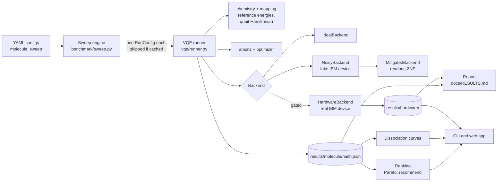
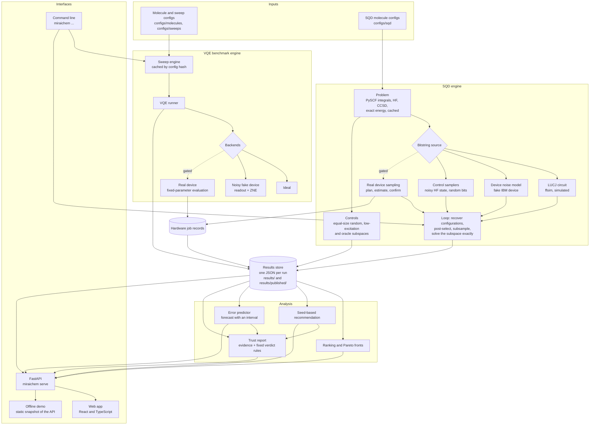
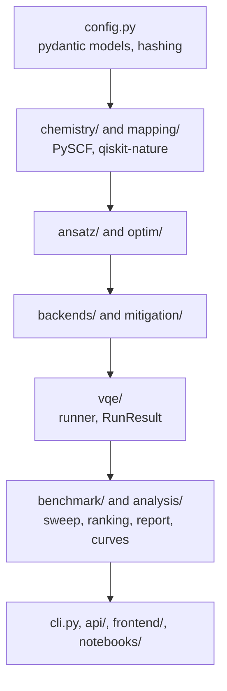
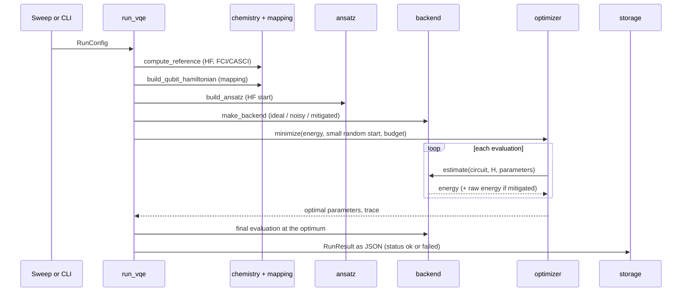
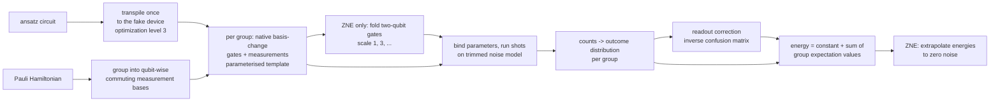
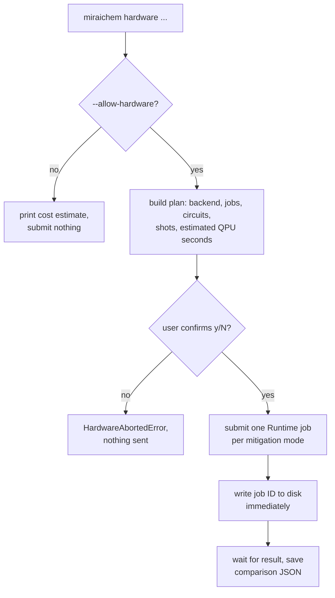
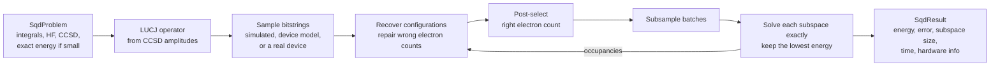
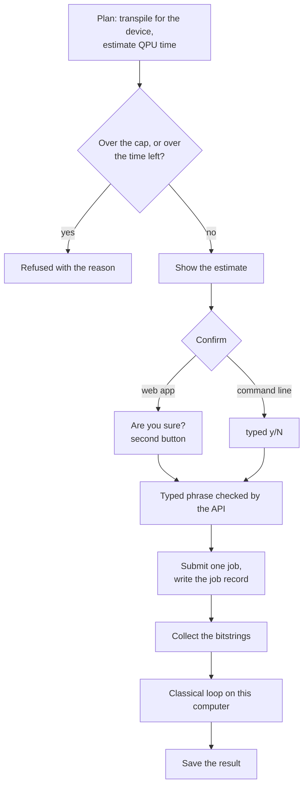

# Architecture

MiraiChem is a pipeline that turns a molecule description into a ranked, cost-aware recommendation of
how to run VQE on a noisy IBM quantum backend. This document explains how the code is organised, how
data flows through it, and where to extend it. For the why behind individual choices see
[DECISIONS.md](DECISIONS.md); for the generated numbers see [RESULTS.md](RESULTS.md).

## 1. The big picture



Everything is driven by **configs** and **saved results**. A run is fully described by a `RunConfig`; its
outcome is one JSON file named by the config's hash. Ranking, curves, the report and the web app only read
those files, which is why the app works offline and a sweep can be stopped and resumed.

### 1.1 The whole system

The diagram above is the VQE pipeline. MiraiChem has two engines that write into the same kind of results
store, and a layer on top that turns saved results into recommendations, forecasts and a trust verdict.



How the pieces relate:

- **Two engines, one store.** VQE runs and SQD runs are different records (`results/<molecule>/` and
  `results/sqd/<molecule>/`), each named by a config hash, and both are read back the same way by the API.
- **Controls are part of the SQD engine, not a separate tool.** `sqd/controls.py` solves the same problem on
  subspaces chosen without a circuit, and the `sampler` option on `SqdConfig` replaces the circuit inside the
  whole loop. Both write ordinary results, so the web app shows them like any other run.
- **The trust report reads, it does not compute chemistry.** `api/trust.py` takes the studies, device blocks,
  hardware results, predictor forecast and SQD groups the API already returns, lists what was checked, and
  turns the list into a verdict by fixed rules that it returns with the report.
- **Hardware is a branch off both engines**, always behind a plan, an estimate and a confirmation (4.2 and
  4.3). Everything else works offline.

## 2. Layers

The package (`src/miraichem/`) is layered: a layer imports from the layers above it in this list. There is one
deliberate exception: the small pure helpers `benchmark/metrics.py` (error and chemical-accuracy functions)
and `benchmark/storage.py` (load and save) are also used by `vqe/` and `backends/hardware_eval.py`.



| Layer | Modules | Responsibility |
|---|---|---|
| Configuration | `config.py` | `MoleculeConfig`, `RunConfig`, `SweepConfig`; validation; the 12-character config hash; rules for invalid combinations (for example L-BFGS-B only on the ideal backend) |
| Chemistry | `chemistry/molecule.py`, `active_space.py`, `classical.py` | PySCF molecule, active-space indices, HF and FCI/CASCI reference energies (`ClassicalReference`, total energies in Hartree) |
| Mapping | `mapping/mappers.py`, `hamiltonian.py` | Jordan-Wigner or Parity mapper; `build_qubit_hamiltonian` returns a `QubitProblem` (Pauli operator, constant `energy_shift`, qubit and particle counts, the mapper); `exact_ground_energy` as a correctness check |
| Ansatz | `ansatz/uccsd.py`, `hardware_efficient.py` | UCCSD and hardware-efficient circuits, both starting from the Hartree-Fock state; `build_ansatz` returns the circuit plus parameter count and logical depth |
| Optimizers | `optim/optimizers.py` | COBYLA, SPSA (own seeded implementation) and L-BFGS-B behind one `minimize` function; `maxiter` is a budget of energy **evaluations** for all three, so comparisons are fair; every evaluation is recorded |
| Backends | `backends/base.py`, `ideal.py`, `noisy.py`, `hardware.py`, `hardware_eval.py` | Anything that can estimate `<psi(theta)|H|psi(theta)>` (the `EnergyBackend` protocol); see section 4 |
| Mitigation | `mitigation/readout.py`, `zne.py`, `mitigated.py` | Readout correction, gate-folding ZNE, and a wrapper that returns mitigated and raw energies together |
| VQE | `vqe/runner.py`, `result.py` | `run_vqe` runs one configuration and never raises; `RunResult` is the saved record |
| Benchmark | `benchmark/sweep.py`, `storage.py`, `metrics.py`, `ranking.py`, `ranking_scan.py`, `report.py` | Sweep engine and cache, result storage, metrics, ranking, scan ranking, report generation |
| Analysis | `analysis/dissociation.py`, `plots.py` | Bond-length scans and figures (matplotlib for documents, plotly for interactive figures) |
| Prediction | `predict/` | The error predictor: features from the transpiled circuit and device noise, a random forest, an 80% interval, and held-out configuration and device tests |
| SQD | `sqd/` | The SQD engine, its controls and its hardware path (4.3) |
| Interfaces | `cli.py`, `api/`, `frontend/`, `notebooks/` | Command line, web API (including `api/sqd.py` and `api/trust.py`) and web app (React), demo notebook |

## 3. What happens in one run



Key points:

- **Total energy.** The qubit Hamiltonian holds only the electronic part. The runner adds the constant
  `energy_shift` (nuclear repulsion plus any frozen-core energy) so every reported energy is a *total*
  energy, directly comparable to the PySCF reference.
- **Fair budgets.** `maxiter` counts energy evaluations, not optimiser iterations (SPSA uses 2 per step).
- **Failure isolation.** `run_vqe` catches any exception and returns a `RunResult` with `status="failed"`
  and the error message. A failed run is saved, never cached as a success, and retried on the next sweep.
- **Provenance.** Each result records the config, seed, library versions and git commit.

## 4. Backends

All backends implement the same small protocol (`backends/base.py`): `estimate(circuit, observable,
parameter_values) -> EstimateResult(value, std_error, metadata)`, plus `info()` and `total_shots`.

| Backend | Used for | How it works |
|---|---|---|
| `IdealBackend` | Upper bound, fast development | Exact statevector expectation values |
| `NoisyBackend` | Predicting real-device behaviour | Aer simulator built from a fake IBM device (noise model, gate set, coupling map); samples real shots |
| `MitigatedBackend` | Readout and ZNE mitigation | Wraps `NoisyBackend`; returns the mitigated value and the raw value |
| `HardwareBackend` | Real IBM devices | Qiskit Runtime `EstimatorV2`; heavily gated, see below |

### 4.1 The noisy measurement pipeline

We run the measurements ourselves because mitigation needs raw counts and control over the circuits.



- **Transpile once**, bind parameters per evaluation. Transpiled depth and two-qubit gate counts are what
  get reported (not the logical circuit's).
- **Noise-model trimming.** Aer reprocesses the whole noise model on every call, so a 127-qubit device is
  about 8 times slower than needed for a 4-qubit circuit. `_trim_noise_model` keeps only the errors on the
  qubits the circuit uses; a test shows the counts are identical to the full model.
- **Determinism.** Each evaluation gets a seed derived from the run seed, so a run is reproducible.
- **Mitigation.** Readout: two calibration circuits give per-qubit confusion matrices that are inverted on
  each group's outcome distribution. ZNE: every two-qubit gate is repeated (G, then G G G, ...), the energy
  is measured at each noise scale, and a linear (or Richardson) fit gives the zero-noise value.

### 4.2 The hardware safety gates

Hardware time is scarce (the free plan allows 600 s of QPU time per period), so the hardware path is
defensive by design:



- **Fixed-parameter evaluation.** We take the optimal parameters found on the noisy simulator and evaluate
  the energy on the device once per mitigation setting, instead of running the optimisation there. It costs
  a few short jobs instead of hundreds and directly tests whether the simulator predicts the device.
- **Job IDs on disk** the moment a job is submitted, so results can be re-fetched (`hardware-fetch`) if the
  session dies. Fetching uses no QPU time.
- **One combined confirmation** covers all jobs of a run; declining raises before any estimator is built.
- **Secrets** come from `.env` (never committed); the dry run works without a token.
- **Tests never submit.** Hardware tests use a fake service and estimator.

### 4.3 The SQD engine

SQD (sample-based quantum diagonalization) reaches molecules too large for VQE on today's devices. Only the
sampling step is quantum; everything after it is classical.



| Module | Responsibility |
|---|---|
| `sqd/problem.py` | SCF (RHF, or ROHF for open-shell), active space, integrals in ffsim's orbital basis, Hartree-Fock, CCSD and (when small or cached) exact energies |
| `sqd/sampler.py` | The LUCJ operator and state, sampling, device-friendly interaction pairs, and the two control samplers |
| `sqd/noise.py` | A device-calibrated noise model: per-qubit readout errors plus the chance a shot survives every gate |
| `sqd/pipeline.py` | The loop: recover, post-select, subsample, solve; the first round uses the raw samples' occupancies, later rounds use the previous solution |
| `sqd/hardware.py` | Plan (transpile, estimate), submit, collect, and finish a saved job later |
| `sqd/controls.py` | Equal-size subspaces for the control experiments (random, low-excitation, oracle) |
| `sqd/config.py`, `result.py`, `storage.py` | Config and hash (new fields are left out of the hash while unset), the saved record, JSON storage |

The SQD hardware gates mirror the VQE ones (4.2) and add three more: a plan expires after 30 minutes, one
plan can be submitted once, and a plan whose estimated QPU time is over the cap (120 s by default) cannot be
submitted. The job record is written the moment the job is accepted.



## 5. Data model and storage

```
results/
├── <molecule>/<config_hash>.json     one RunResult per run
├── curves/<molecule>_<hash>.json     one DissociationCurve per scanned configuration
├── hardware/
│   ├── <molecule>/<hash>_hw.json     one HardwareResult per hardware comparison
│   └── jobs/<job_id>.json            written at submission time
├── sqd/<molecule>/<hash>.json        one SqdResult per SQD run (control samplers included)
├── controls/<molecule>.json          equal-size subspace comparison for one molecule
├── exact/<key>.json                  cached exact energies (large SQD problems; not committed)
├── summary/summary.{csv,parquet}     flat table of all runs (miraichem report)
└── published/                        committed copy of the above, browsable in the web app
```

- **`RunConfig.config_hash()`** = first 12 hex characters of SHA-256 over the sorted-key JSON of the config.
  Same config, same hash; any change (bond length, seed, mitigation, ...) gives a different hash. The hash
  names the result file and drives caching.
- **`RunResult`** (pydantic, `vqe/result.py`) holds the config, status, energies, error in mHa,
  chemical-accuracy flag, qubit and parameter counts, logical and transpiled depth, two-qubit gates, evaluation
  and shot counts, wall time, the convergence trace (with the unmitigated trace when mitigation is on), optimal
  parameters, backend info, library versions, git commit and timestamp.
- **`results/` is gitignored** except `results/published/`, so a fresh clone can inspect the numbers behind the
  README without recomputing anything.

## 6. Benchmark, ranking and recommendation

- **Sweep engine** (`benchmark/sweep.py`): `SweepConfig.expand()` builds the Cartesian product and drops
  invalid combinations and user-excluded ones; ideal runs keep a single shot setting. `run_sweep` skips
  results already saved successfully (unless `--force`), runs the rest in-process or in a `spawn` process pool,
  and never lets one failure stop the others.
- **Ranking** (`benchmark/ranking.py`): a weighted score (accuracy 0.7, two-qubit gates 0.2, shots 0.1 by
  default; error on a log scale; each term min-max normalised), plus Pareto fronts for error vs shots and error
  vs gates. `recommend()` returns the cheapest run that reaches chemical accuracy, or the best-scoring run if
  none does, with a justification built from the run's real numbers.
- **Scan ranking** (`benchmark/ranking_scan.py`): groups runs by configuration across bond lengths and judges
  them on worst-case error and coverage (share of bond lengths within chemical accuracy), because a
  configuration that is accurate at equilibrium can fail when the bond is stretched.
- **Report** (`benchmark/report.py`): `miraichem report` writes `docs/RESULTS.md` from saved files only, with
  simulator and hardware results in separate sections.

### 6.1 The trust report

`api/trust.py` answers "how much should I rely on this recommendation?". For one recommended setup it lists
the checks that were made, each as pass, warning, fail or no data, and returns a verdict:

| Check (VQE) | Passes when |
|---|---|
| Seeds | at least 5 seeds (3 or 4 is a warning, fewer fails) |
| Accuracy | at least half of the seeds are within 1.6 mHa |
| Exact reference | always, for these small molecules |
| Devices | the same setup is recommended on every compared device |
| Error forecast | the measured mean is inside the predictor's 80% range |
| Real device | a matching hardware run is within chemical accuracy (better than Hartree-Fock is a warning) |

For SQD the same list is used with: closer to the exact energy than CCSD, the circuit beating the equal-size
and swapped-loop controls, holding up as the bond stretches, and any real-device run (a run that solved most
of the space is a warning, because it shows the hardware path works and not that SQD tolerates noise).

The verdict follows four fixed rules, returned with every report: fewer than 3 seeds is "not enough
evidence"; not reaching chemical accuracy in half the seeds is "not yet trusted"; reliably accurate with any
warning or failure is "partly trusted"; otherwise "trusted". A check with no data does not count against a
setup and is shown as such. The rules are tested in `tests/test_trust.py`.

## 7. Interfaces

| Interface | Entry point | Notes |
|---|---|---|
| CLI | `miraichem` (`cli.py`, Typer) | `reference`, `run`, `sweep`, `rank`, `curve`, `report`, `hardware`, `hardware-fetch`, `sqd`, `sqd-hardware`, `sqd-hardware-fetch`, `serve`, `predictor train` |
| Error predictor | `predict/`, `miraichem predictor train` | A random forest that forecasts a noisy run's error from the transpiled circuit, optimizer, mitigation, shots and device noise; validated on unseen configurations and devices; used by the New run page |
| Web app | `miraichem serve` | A FastAPI layer (`api/`) over the same package plus a React interface (`frontend/`): browse and rank saved results, seed-based recommendations, the trust report, the SQD page (results, stretched-bond study, controls, scaling, 3D viewer), simulator runs and sweeps as background jobs. SQD on real hardware can be started from the SQD page after a plan and an "are you sure" step; VQE hardware stays in the command line. `miraichem serve --no-allow-hardware` removes the app's access to IBM |
| Offline demo | `miraichem export-demo`, `npm run build:demo` | The API's answers saved as static files, so the same interface runs with no server (read-only) |
| Notebook | `notebooks/01_h2_end_to_end_demo.ipynb` | Only calls the package; saved with outputs |

## 8. Testing

About 250 Python tests (251 passed in the last full run, about 7 minutes) and 13 frontend tests (`npm test`) run without a network or hardware (`pytest -q`).

| Area | What is checked |
|---|---|
| Correctness anchors | HF and FCI energies for H2 against known values; qubit Hamiltonian plus shift equals PySCF within 1e-6 Ha for H2 and LiH under both mappings; qubit counts; HF circuit energy equals PySCF HF; ideal UCCSD reaches chemical accuracy |
| Determinism | Same config and seed give the same noisy result; SPSA seeding; config hashing |
| Noise and mitigation | The noiseless pipeline equals the exact statevector (X, Y and Z bases); readout correction removes a readout-only noise model; ZNE moves a device-noise energy toward the ideal value; folding preserves the circuit's unitary; trimming the noise model changes nothing |
| Benchmark logic | Sweep caching, `--force`, failure isolation, parallel equals serial; ranking, Pareto and recommendation on synthetic data, including the equilibrium-vs-scan case |
| Safety | Hardware disabled without the flag; declined confirmation submits nothing; job IDs recorded; options valid |
| SQD | The subspace solver reproduces the exact energy when every string is used and the Hartree-Fock energy with one; the control samplers, the config hash staying the same for old results, open-shell molecules, the device noise model, and the hardware plan, gates and job records with a fake device |
| Trust report | Every check and every verdict rule on synthetic data (pass, warning, fail, no data), and the published data through the API |
| Interfaces | The web API exercised through FastAPI's test client (including a real run started through it), frontend unit tests (`npm --prefix frontend test`); report and export; the notebook is clean (an opt-in test executes it end to end: `pytest -m notebook`) |

Linting (`ruff`) and types (`mypy`, lenient) run clean on `src/`.

## 9. How to extend it

| To add... | Do this |
|---|---|
| A molecule | Add `configs/molecules/<name>.yaml` (geometry template with `{bond_length}`, basis, active space). Check the exact-energy test for it |
| An ansatz | Add a builder in `ansatz/` returning a `QuantumCircuit` that starts from the HF state, register it in `build_ansatz`, and add the name to `AnsatzKind` in `config.py` |
| An optimizer | Add a branch in `optim/optimizers.py::minimize` that respects the evaluation budget and records every evaluation; add the name to `OptimizerKind` |
| A backend | Implement the `EnergyBackend` protocol and return it from `vqe/runner.py::make_backend` |
| A mitigation method | Extend `MitigatedBackend` (or wrap it) so it returns the mitigated value and the raw value in `metadata['unmitigated']` |
| A ranking criterion | Add a term to `Weights` and `rank_results` (and `ranking_scan.py` for scans) with a unit test on synthetic data |

## 10. Known limitations of the design

- The tensored readout model ignores correlated measurement errors; the noisy simulator ignores drift,
  crosstalk and leakage.
- ZNE folds only two-qubit gates, so a "scale factor" is a multiple of two-qubit-gate noise.
- Variances under mitigation come from the raw distributions (an approximation).
- Parallel runs use processes, so very large sweeps are limited by memory and cores, not by the code.
- The hardware path evaluates fixed parameters; it does not optimise on the device.
